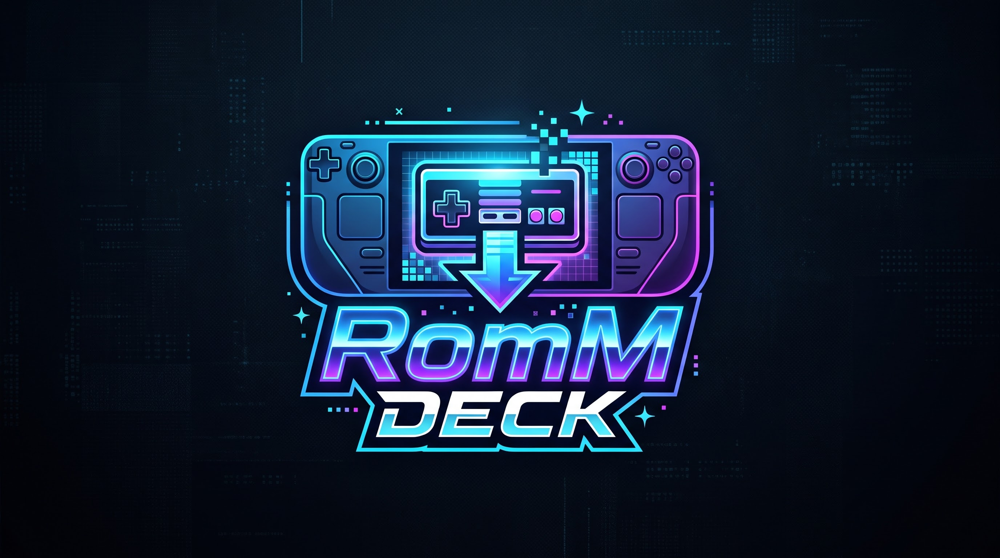
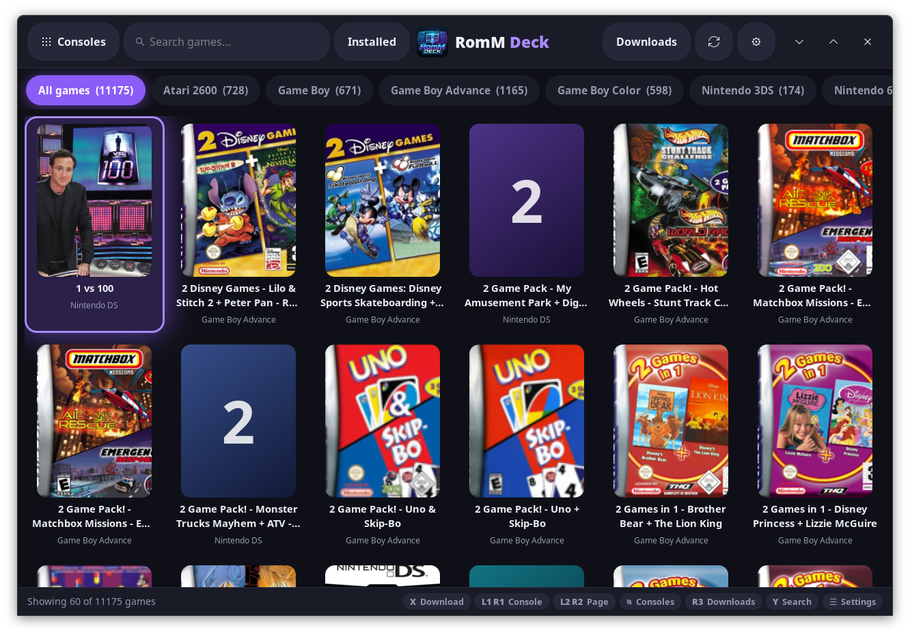
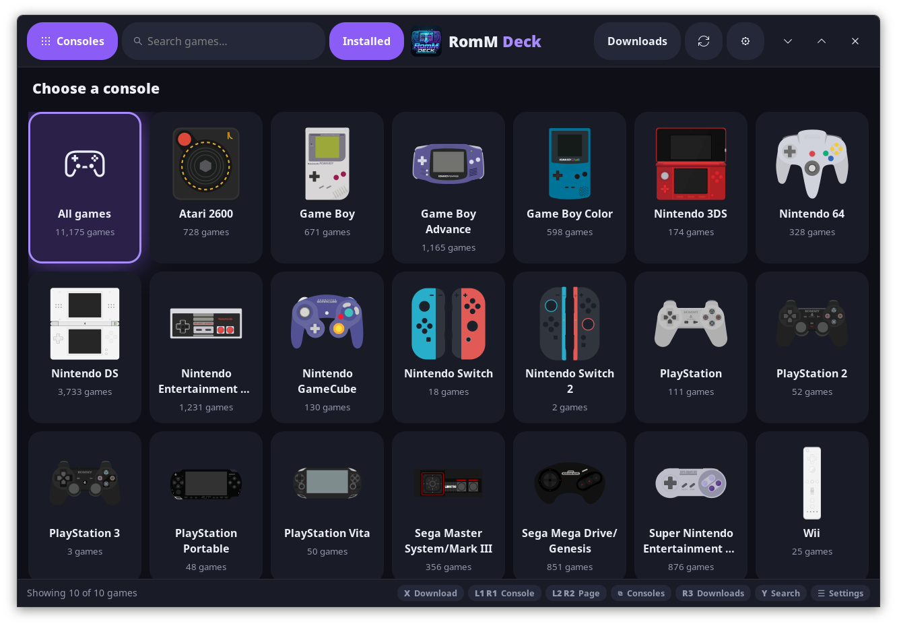
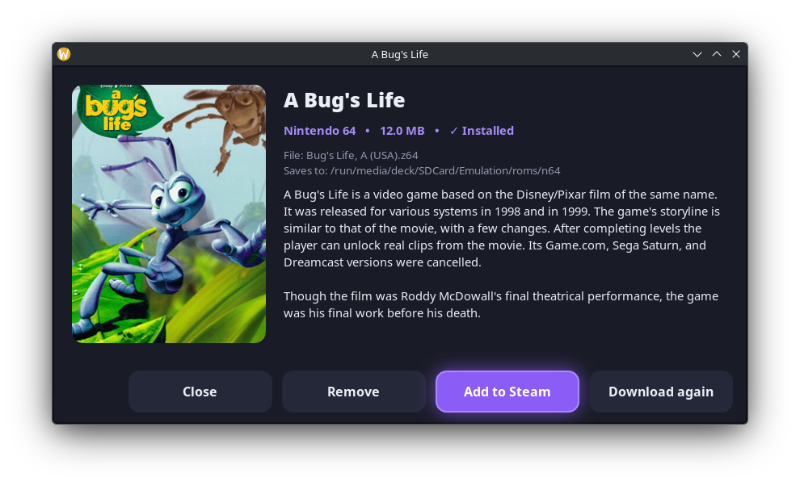
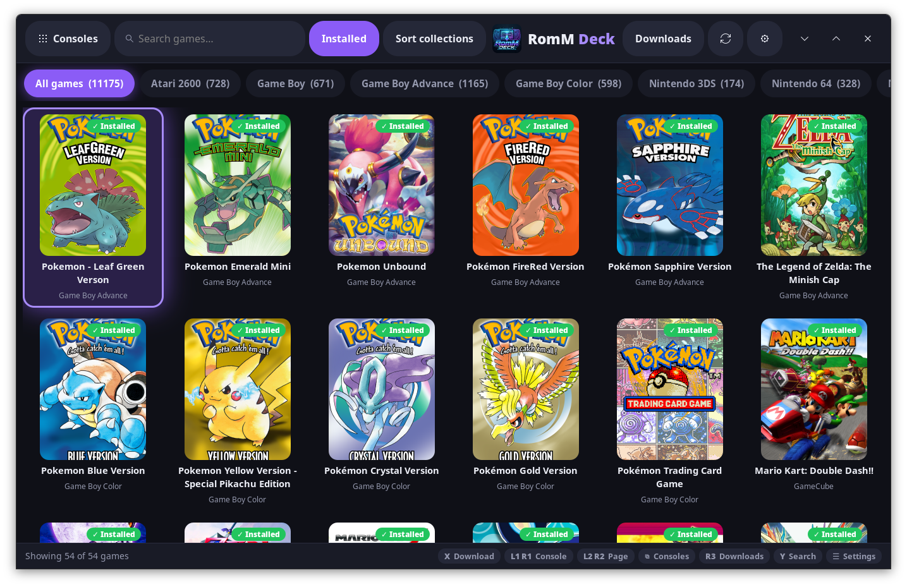
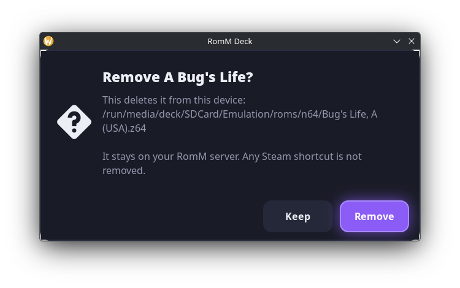
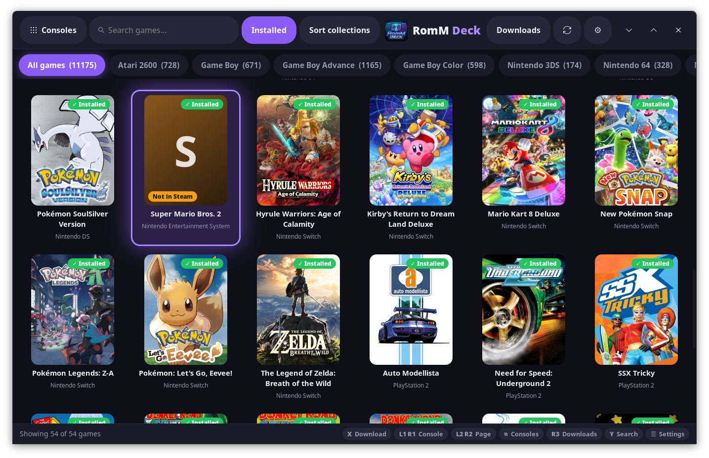
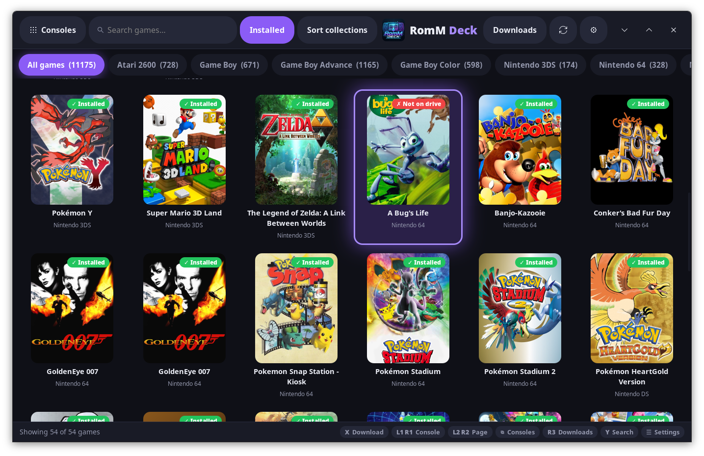
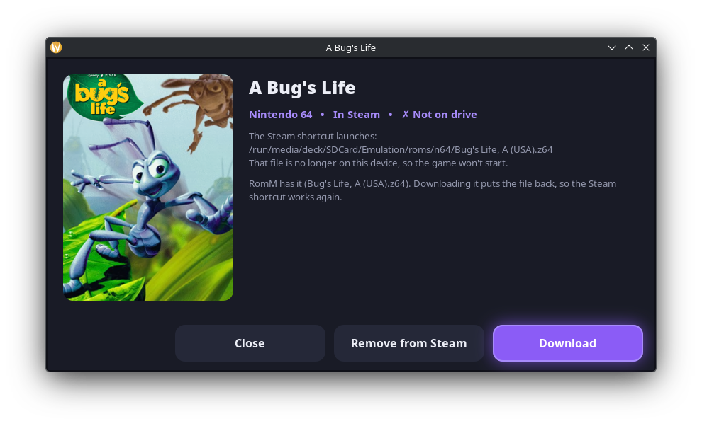

# RomM Deck

A Steam Deck app for browsing a [RomM](https://github.com/rommapp/romm) server,
downloading games straight into the matching EmuDeck ROM folder, and adding
them to the Steam library.

## Features

- **Browse by console** using the swipeable tab strip or the Consoles page,
  which shows each console with its logo and game count
- **Installed filter**: the Installed button in the header shows only the games
  already on this device, for one console or all of them, and works with search.
  It reads the ROMs folder and Steam's library directly, so it opens instantly,
  works offline, and marks games that are not in Steam yet
- **Remove installed games** from the game's details dialog to free up space
- **Search** across the whole library or within one console
- **Cover art** from the RomM server, with a tinted placeholder when a game has none
- **Automatic download location**: each game goes to the EmuDeck folder for its
  system (for example RomM's GameCube goes to `gc`). Unknown consoles ask once
  and remember the answer
- **Several downloads at once**: queue as many games as you like; two download
  at a time and the rest wait. A Downloads page shows progress and lets you
  cancel or retry each one
- **Add to Steam** in one go when the downloads finish, reusing the launch settings of games
  already added by Steam ROM Manager
- **Steam collections**: games added to Steam are also filed in a collection for
  their console, named after the RomM platform (for example "Nintendo 64")
- **Sort collections**: sorts the games already in Steam into console collections,
  and finds every game in your ROMs folder that is missing from Steam using
  Steam ROM Manager's own parsers, then adds it. Works offline; RomM is not used
- **Offline mode**: if the RomM server can't be reached, the app opens on the
  installed games, with a tab per console folder
- **Full Steam artwork**: portrait cover, wide tile, banner, logo and icon, laid
  out the same way Steam ROM Manager does
- **Full screen in Gaming Mode**, with no window frame
- **Controller, touch and keyboard** navigation
- **Dark and light themes**

## Screenshots

| Consoles page | Game details |
| --- | --- |
|  |  |

| Installed filter | Remove confirmation |
| --- | --- |
|  |  |

| On the drive, not in Steam | In Steam, not on the drive |
| --- | --- |
|  |  |

| Details of a game that is not on the drive |
| --- |
|  |

## Requirements

SteamOS with [EmuDeck](https://www.emudeck.com/) installed. The app uses only
what SteamOS already ships (Python 3, GTK 3 via PyGObject, pycairo), so there
is nothing to install.

Tested against RomM 5.4.1.

## Install (AppImage)

1. Get `RomM-Deck-x86_64.AppImage` and `Install RomM Deck.desktop` together on
   your Desktop. KDE only runs the launcher on a click from there. (`./build.sh`
   can copy both to the Desktop for you.)
2. In Desktop Mode, double-click **Install RomM Deck** (the `.desktop` file). It
   makes the AppImage executable and opens the install window. If KDE asks
   whether to trust it, choose Execute. If it still will not run, right-click it
   and pick Run, or run `chmod +x "Install RomM Deck.desktop"` first. If it does
   nothing from another folder, move both files to the Desktop.
3. In the install window, choose what you want:
   - **Install** to `~/Applications/RomM-Deck.AppImage`
   - **Add to the application menu**
   - **Add to my Steam library** (off by default). If Steam is running it is
     restarted so the shortcut shows up, with cover, banner and icon artwork
4. Press Install. Launch RomM Deck from the application menu, or from your
   Steam library in Game Mode if you added it.

Running the AppImage directly (double-click it, or `chmod +x` it first if the
permission was lost) opens the same install window. The launcher also retries
without FUSE if the AppImage will not start normally, and shows a dialog with
the error if it still fails.

To update, run the launcher again and press **Reinstall**. Your settings are kept.

You can also pick "Run without installing". Run the installed AppImage again
and it starts the app directly; to reinstall or uninstall, run the AppImage with
`--install`. In Game Mode the installer is never shown.

## Build the AppImage

From a clone of this repository:

    ./build.sh

The script needs [appimagetool](https://github.com/AppImage/appimagetool/releases).
It uses one on your `PATH` if there is one. Otherwise it asks whether to
download it to `build/appimagetool`, and aborts if you say no. When the build
finishes it writes `RomM-Deck-x86_64.AppImage` and the double-click launcher
`Install RomM Deck.desktop` in the repository root, then asks
whether to remove the downloaded `appimagetool` (a copy on your `PATH` is never
touched). Last, it offers to copy the AppImage and the launcher to your Desktop,
which is where KDE will run the launcher when you click it. The Desktop folder
is skipped if you built inside it.

To skip the prompts, run `./packaging/build-appimage.sh` directly with
`appimagetool` on your PATH, or set `APPIMAGETOOL=/path/to/appimagetool`.

## Run from source

    git clone <this repository> ~/Projects/romm-deck
    ~/Projects/romm-deck/romm-deck

To use it from Game Mode, add `romm-deck` to Steam as a non-Steam game.

## Setup

On first launch the Settings dialog opens. Enter:

- **RomM server URL**, for example `https://romm.example.com`
- **Username and password**, or an **API token** (`rmm_...`) created in RomM.
  If a token is set it is used instead of the password
- **EmuDeck ROMs folder** and **launchers folder**. Both are filled in
  automatically from EmuDeck's own settings
- **SteamGridDB key** (optional), used for Steam library artwork. Create one for
  free at steamgriddb.com under Preferences, API

Settings are saved to `~/.config/romm-deck/config.json`, readable only by your
user. Credentials are stored there in plain text.

## Controls

| Controller | Action |
| --- | --- |
| D-pad / left stick | Move |
| A | Open the selected game, or press the highlighted button. On the Downloads page, tick a finished game for Steam |
| X | Queue the selected game for download. On the Downloads page, cancel or retry |
| R3 | Open or close the Downloads page |
| B | Back |
| L1 / R1 | Previous / next console |
| L2 / R2 | Page up / down |
| View | Open or close the Consoles page |
| Y | Jump to search |
| Start | Settings |

With touch, tap to open and drag to scroll, including the console tab strip.

Keyboard: arrow keys and Enter, `Ctrl+F` to search, `Ctrl+PageUp` /
`Ctrl+PageDown` to change console, `F5` to refresh, `Esc` to go back. Refresh is also the round arrow button in
the header.

The controller is read directly when the app is launched through Steam. Launched
from the desktop, Steam presents the controller as a mouse and keyboard instead.

## Downloading

Open a game and press Download, or press X on a game in the grid to queue it
without opening it. The Downloads button in the header shows how many are in
progress and opens the Downloads page.

When every download has finished the app asks once whether to add the new games
to Steam: add all of them, choose which on the Downloads page, or skip. On the
Downloads page, tick the finished games you want and press "Add to Steam".

## Managing installed games

Games already on the device show a green "Installed" badge, and an orange
"Not in Steam" badge when no Steam shortcut launches them. A Steam shortcut whose
game file is no longer in the ROMs folder shows a red "Not on drive" badge.

| On the drive | In Steam | Card shows | Details offer |
| --- | --- | --- | --- |
| Yes | Yes | Steam name and cover, "Installed" | Add to Steam (fills in missing artwork), Remove |
| Yes | No | Title from the file name, "Installed" and "Not in Steam" | Add to Steam, Remove |
| No | Yes | Steam name and cover, "Not on drive" | Remove from Steam, Download (when RomM has it) | Press the
**Installed** button in the header to list only those games; press it again to
go back to the full library.

The Installed view never contacts RomM. It lists the games in your ROMs folder
(the same scan as Sort collections) together with any Steam shortcut that
launches a file in that folder, so it appears straight away and works offline.
A game in Steam shows its Steam name and the portrait artwork Steam already has
for it; a game not in Steam shows a title cleaned up from the file name. The
details of an installed game show where the file is and offer Add to Steam and
Remove.

A "Not on drive" game is a Steam shortcut that won't start because its file is
gone (for example after Remove). Its details show the file the shortcut expects
and offer:

- **Remove from Steam**: deletes the shortcut and takes it out of RomM Deck's
  collections (a collection left empty is deleted). Any re-add still waiting for
  a Steam restart is cancelled, so the restart does not bring it back.
- **Download**: available when RomM has the game (it is looked up when the
  details open; not offline). If RomM's file is the one the shortcut launches,
  downloading puts it back and the shortcut works again. If RomM only has the
  same title under another file name, the old shortcut is removed and the new
  download is offered to Steam as usual.

Removing an installed game from the Installed view now shows it again as "Not on
drive" while its Steam shortcut remains.

If the RomM server can't be reached when the app starts, it opens on the
Installed view with a tab for each console folder that has games, and the status
bar says it is offline. Pressing **Installed** again tries to reconnect.

To free space, open an installed game and press **Remove**, then confirm. This
deletes the file (or folder, for multi-file games) from the device. The game
stays on your RomM server, and any Steam shortcut already created for it is not
removed.

## Adding games to Steam

Steam only reads its shortcuts file when it starts, so a game added from RomM
Deck appears in the library after Steam restarts. The app offers to restart
Steam for you, or you can add several games and restart once.

A backup of the shortcuts file is written next to it as
`shortcuts.vdf.rommdeck-bak` before every change.

### Collections

Each game added to Steam is also put in a collection named after its console,
for example "Nintendo 64" or "Super Nintendo Entertainment System". The name
comes from the roms folder the game is in, using a table of RomM's own platform
names built into the app (`FOLDER_NAMES` in `rommdeck/emudeck.py`, covering every
EmuDeck folder), so no server is needed. A few are shortened from RomM's, such
as "GameCube" for "Nintendo GameCube". Regional folders share one collection
(`megadrivejp` and `megadrive` both go to "Sega Mega Drive/Genesis"). The
collection is created the first time it is needed. Steam rewrites its collections file while it runs, so
the app records the change and re-applies it during the Steam restart it offers.
Collections made by RomM Deck are separate from ones made by Steam ROM Manager,
so a console may briefly have both. Turn this off with the "Add games to a Steam
collection per console" option in Settings.

The **Sort collections** button in the header fixes collections for games that
are already in Steam. It reads Steam's shortcut list, works out which rom file
each shortcut launches, and puts every game that is not yet in its console
collection into it, leaving games that are already sorted alone. Each game is
kept in just one RomM Deck collection: if a console's name changes (GameCube was
once "Nintendo GameCube"), its games move to the new collection and the old one
is deleted once empty. Collections you, Steam or SRM made are never changed. It
never contacts the RomM server, so it works offline. The status bar also says how many
Steam shortcuts point at files that are missing; find them on the Installed view.

It then scans the ROMs folder the way Steam ROM Manager does and adds every game
that has no Steam shortcut. When SRM is set up (EmuDeck does this), its enabled
parsers are used as is: each one's folder, glob (recursive, with its extension
list, so emulator files and data folders are ignored), launch command, title
cleanup, your SRM exceptions (renamed or excluded titles) and SRM's own matched
titles. The shortcut it writes is the one SRM would write. The folder scanned is
always the ROMs folder set in RomM Deck's Settings, even if SRM points elsewhere.
Games no SRM parser matches (or all games, without SRM) are found by built-in
per-system extension rules and launched with the EmuDeck launchers. Files a
`.cue` or `.m3u` refers to are not added separately, and a `.zip` or `.7z` in a
disc system counts only if it is over 50 MB, so emulator patch archives are skipped.

New games are titled as SRM would title them (or cleaned up from the file name)
and get their artwork from SteamGridDB when a key is set in Settings, the same
way SRM does; without a key they are added without artwork. Restart Steam when
asked for the new games and collections to show up.

### Artwork

Each game added to Steam gets five images in Steam's `grid` folder:

| Image | File | Size |
| --- | --- | --- |
| Portrait cover | `<appid>p.png` | 600x900 |
| Wide tile | `<appid>.png` | 920x430 |
| Banner | `<appid>_hero.png` | 1920x620 |
| Logo | `<appid>_logo.png` | transparent |
| Icon | `<appid>_icon.png` | square |

With a SteamGridDB key, all five come from the best SteamGridDB match for the
game's name. Without a key, or when SteamGridDB has no match, the cover, wide
tile, banner and icon are built from the RomM cover and first screenshot; there
is no logo in that case, so Steam shows the game's name as text.

Images that already exist are never overwritten. Pressing "Add to Steam" on a
game that is already in the library keeps its entry and fills in any missing
images.

### Launchers

If a system has no game in Steam yet, RomM Deck falls back to a built-in table
of EmuDeck launchers. PS Vita and Switch 2 are not in that table.

## Project layout

| File | Purpose |
| --- | --- |
| `rommdeck/app.py` | GTK interface |
| `rommdeck/romm.py` | RomM API client |
| `rommdeck/srm.py` | Finds games on disk using Steam ROM Manager's parsers |
| `rommdeck/emudeck.py` | Console-to-folder mapping and emulator launch commands |
| `rommdeck/steam.py` | Reading and writing Steam's `shortcuts.vdf` and artwork files |
| `rommdeck/artwork.py` | Fetching and building Steam library artwork |
| `rommdeck/gamepad.py` | Controller input |
| `rommdeck/style.py` | Theme and cover-art rendering |
| `rommdeck/config.py` | Settings |
| `rommdeck/installer.py` | Install window used by the AppImage |
| `Install RomM Deck.desktop` | Double-click installer: runs the AppImage's install window |
| `build.sh` | Builds the AppImage, fetching appimagetool if you agree |
| `packaging/` | AppImage entry point, packaging script, and the source of the installer launcher (`installer-launcher.sh`, turned into the `.desktop` file by `make-launcher.py`) |
